# HNTurboVec: all of Hacker News in 5.3 GB, searchable

Every Hacker News item ever posted (49.3 million stories, comments, jobs and polls, from October
2006 to August 2026) in one 5.34 GB file. The text comes back byte for byte, and you can search it
by meaning and by keywords, with filters by date, type and author. It runs on a laptop CPU, inside
a RAM budget you choose.

```python
import hnz

with hnz.open(r"D:\hn\hn-2026-08.hnz", ram="2GB") as hn:
    for h in hn.search("how do I deal with burnout as a software engineer", k=5,
                       since="2015", until="2018", types="comment"):
        print(h.date, h.by, h.story_title, h.text[:120])
    print(hn.get(1).title)          # 'Y Combinator', the first HN item
```

| | |
|---|---|
| **5.34 GB** | all of HN: text, metadata, semantic index, word index and both models. The Parquet dump is 12.4 GB, the raw JSON about 24 GB |
| **Lossless** | every item's original HTML, byte for byte. Checked against the sources: 0 differences in 49.3 M items |
| **~2.3 s** | a cold hybrid search with reranking over all 49.3 M items, on a 16-thread laptop CPU. Keyword search ~0.2 s, `get()` ~80 ms |
| **`ram="2GB"`** | models, indexes, caches and the working memory of every query stay inside the budget (the process used ~1.45 GB) |
| **One file** | the read-only block `hn.hnzb` plus the query embedder, with a hash per part and four levels of verification |

What you need today: Windows 10 or 11 on x86-64 with AVX2, Python 3.10 or later, and a block. The
block is not published for download yet; [you build it](#build-the-block-yourself) from the public
dataset in about a week on a laptop.

<p align="center"></p>

## Contents
- [The numbers](#the-numbers)
- [Quick start](#quick-start)
- [How it works](#how-it-works)
- [Quality and speed](#quality-and-speed)
- [Tests](#tests)
- [Tools](#tools)
- [Build the block yourself](#build-the-block-yourself)
- [Repository map and documentation](#repository-map-and-documentation)

## The numbers

<picture>
  <source media="(prefers-color-scheme: dark)" srcset="doc/img/size-dark.svg">
  
</picture>

zstd-19 with a trained dictionary needs 9.1 GB for the text and metadata alone, without any search.
The block holds the same data in 5.34 GB, together with the search indexes and the models. A bit
more than half of it is text:

<picture>
  <source media="(prefers-color-scheme: dark)" srcset="doc/img/diagram-block-dark.svg">
  
</picture>

| Part | Bytes | Per item |
|---|---|---|
| Text, arithmetic-coded by a language model (47.4 M records) | 2,813,292,945 | 59 B |
| Semantic vectors (256-bit codes) | 1,516,298,016 | 32 B |
| Word index (BM25 postings of 4.2 M rare terms) | 365,013,098 | 7.4 B |
| Metadata (time, author, score, parent, children) | 284,744,791 | 5.8 B |
| Models: LM 72 MB, tokenizers 4 MB, query embedder 276 MB | 352,112,618 | |
| Directory, fallbacks, padding | 11,671,963 | |
| **Total** | **5,343,133,431** | **108 B** |

## Quick start

Install the wheel (built with `maturin build --release` in `hnz/py`; it pulls `openvino`):

```powershell
pip install hnz-0.1.0-cp310-abi3-win_amd64.whl
```

**From Python.** The full guide is in [hnz/py/README.md](hnz/py/README.md).

```python
import hnz

hn = hnz.open(r"D:\hn\hn-2026-08.hnz", ram="2GB", preload=True)

r = hn.search("rust vs go for backend services", k=10)           # hybrid with reranking, the default
r = hn.search("sqlite", mode="keyword", since="2020", types="story")
r = hn.search(author="pg", types="story", k=20)                  # no query: newest first
r = hn.search("kubernetes for small teams", deadline_ms=1500)    # answers in time, skipping the rerank if needed
for h in r:
    print(h.rank, h.date, h.kind, h.by, h.title or h.story_title, h.link)

item = hn.get(9700000)              # the whole item; item.html is HN's original HTML
vec = hn.embed("hello world")       # the 768-dim query vector
print(hn.memory()["budget"])        # the RAM ledger: limit, used, peak, per class
# in async code: await hn.asearch(...), hn.aget(id), hn.aembed(text)
```

**Over HTTP.** The package installs an `hnz` command:

```powershell
hnz serve --root D:\hn\hn-2026-08.hnz --ram 2GB --threads 8 --port 8088
```

`GET /search?q=…&k=10&from=2015&to=2018&type=comment&by=pg&mode=hybrid` returns JSON. There are
also `/item/<id>`, `/stats` and `/memory`, and `/` is the search page shown above (`/?q=velxio`
opens a search directly). The server is meant for your own machine or a private network. To put
it on the internet, run it behind a reverse proxy.

<p align="center"></p>

## How it works

<picture>
  <source media="(prefers-color-scheme: dark)" srcset="doc/img/diagram-build-dark.svg">
  
</picture>

<picture>
  <source media="(prefers-color-scheme: dark)" srcset="doc/img/diagram-query-dark.svg">
  
</picture>

Five ideas keep it small:

1. **A language model compresses the text.** Each record is arithmetic-coded with the
   probabilities of pythia-70m, which I trained for another 93 minutes on 1% of HN (9% fewer
   bits). Decoding needs exactly the same probabilities as encoding, so the model runs in hnz's own
   Rust engine, with int8 arithmetic, AVX-VNNI kernels and float operations in a fixed order. The
   text takes 59 bytes per item, against 137 with zstd-19 and a trained dictionary.
2. **The stored text doubles as an index.** Each query decodes the first 128 tokens of its
   candidates and scores them again (BM25 over every query word, then a new embedding for the best
   50). That lets the indexes stay small: 256-bit vectors, 32 bytes per item, and BM25 only for rare
   terms such as names, identifiers and products, which is 73% smaller at the same quality.
3. **Items are stored in time order**, so a date filter is a contiguous range found exactly from
   the metadata index.
4. **Memory has a budget.** `ram=` decides what stays in memory and reads the rest from disk, with
   the same results. The working memory of each query is charged to the same budget.
5. **Every part is checked.** Each part has an XXH3-128 hash, known records are decoded when the
   block opens, and `verify-block --level deep` compares every record with its Parquet source.

More detail: [doc/08-block.md](doc/08-block.md) (the block, byte by byte),
[doc/09-rerank.md](doc/09-rerank.md) (search), [doc/07-ram.md](doc/07-ram.md) (memory) and
[doc/05-arquitectura.md](doc/05-arquitectura.md) (the engine). The story of how it got here is in
[doc/POST.md](doc/POST.md).

## Quality and speed

<picture>
  <source media="(prefers-color-scheme: dark)" srcset="doc/img/quality-dark.svg">
  
</picture>

Each eval query is a story's title, and the relevant results are the comments in that story's own
thread. Searching within the query's month, among all 49.3 M items, the hybrid search finds on
average 3.2 relevant comments in the top 10, and keyword search alone 2.6. Without the month
filter the score drops to about 0.05, because this eval counts similar threads from other years as
misses. On a block of only three months the same queries scored 0.24, so the search does not get
worse with 16 times more data.

<picture>
  <source media="(prefers-color-scheme: dark)" srcset="doc/img/latency-dark.svg">
  
</picture>

Most of a cold search is spent decoding the candidates' prefixes (about 1,800 tokens per second
per query on this CPU). Measured in October 2026 on an Intel Core Ultra 7 265H laptop (6 P-cores
and 8 E-cores) with nothing else running.

## Tests

<p align="center"></p>
<p align="center"></p>

- `python scripts/accept_full.py` runs 24 checks of the installed package against the full block,
  using only its public API, in about 30 seconds.
- The Python suite (`pytest hnz/py/tests`, 73 tests) checks lossless `get` against Parquet, the
  same results from disk and RAM, concurrency, that a changed byte anywhere is detected without a
  crash, the memory limits, reranking determinism and the HTTP server.
- The Rust core has 35 unit tests, including bit-exact LM kernels and a corruption matrix.
- The deep verification of the full block compared every record with its source: 0 differences.

[doc/10-tests.md](doc/10-tests.md) explains how to run each level and what it needs.

## Tools

The `hnz` executable (Rust, `hnz/`) builds, checks and queries blocks:

| Command | What it does |
|---|---|
| `hnz pack --stream --spec S --out DIR` | builds a block from the monthly LM segments, the vectors and the global statistics |
| `hnz verify-block BLOCK --level header\|quick\|full\|deep` | checks a block, from its headers up to every record against its source |
| `hnz inspect BLOCK [--project N]` | parts, sizes, bytes per item, and a projection to N items |
| `hnz search`, `hnz get ID`, `hnz serve` | search, print an item, run the HTTP server |
| `hnz eval --file Q.jsonl --rerank [--within-month]` | P@k and MRR on an eval set |
| `hnz build --tier lm`, `hnz globals`, `hnz prompts`, `hnz lexicon` | the steps behind `pack`: LM segments, term frequencies, document prompts, word index |
| `hnz lmtest`, `hnz bench`, `hnz stats` | compression and latency measurements |

Scripts in `scripts/`:

| Script | What it does |
|---|---|
| `download_hn.py` | downloads the dataset (239 months, 12.4 GB); resumable, pinned version, SHA-256 checked |
| `prepare_models.py`, `export_*.py`, `compress_embedder.py` | prepares the models: EmbeddingGemma 2 to OpenVINO int8, the LM to hnz's format |
| `train_lm.py` | continues the training of pythia-70m on HN text (integrated GPU, PyTorch XPU) |
| `p5_build.py` | builds the material of the block month by month: LM segments on the CPU, vectors on the GPU |
| `p6_run.py` | builds, packs, verifies, tests and evaluates in resumable stages (`p6_start.ps1` restarts it at logon) |
| `accept_full.py` | the acceptance checks of the installed package on the full block |

## Build the block yourself

It takes about a week on one laptop, with the CPU and the integrated GPU working at the same time:

```powershell
uv venv .venv --python 3.12
uv pip install --python .venv -r requirements-torch.txt --index-url https://download.pytorch.org/whl/cpu
uv pip install --python .venv -r requirements.txt
.venv\Scripts\python scripts\prepare_models.py          # models into models\
.venv\Scripts\python scripts\download_hn.py             # 239 monthly Parquet files into data\ (12.4 GB)
cd hnz; cargo build --release; cd ..                    # the hnz CLI (Rust stable, x86-64-v3)
hnz\target\release\hnz globals --out work\global (Get-ChildItem data\*\*.parquet | % FullName)   # term frequencies
.venv\Scripts\python scripts\p5_build.py lm             # LM segments on the CPU, ~7 days
.venv\Scripts\python scripts\p5_build.py embed          # vectors on the iGPU, ~4.5 days, at the same time
hnz\target\release\hnz pack --stream --spec scripts\pack-all.json --out work\p6\hn-2026-08.hnz
hnz\target\release\hnz verify-block work\p6\hn-2026-08.hnz --level full
cd hnz\py; maturin build --release                      # the wheel
```

Every long step can resume where it stopped, and `python scripts/p5_build.py status` shows the
progress. Packing takes about an hour and 3.2 GB of RAM. The reason behind each choice, with its
numbers and the experiments that failed, is in [doc/BITACORA.md](doc/BITACORA.md) (36 entries).

## Repository map and documentation

| Folder | Contents |
|---|---|
| `hnz/` | the Rust engine (library and `hnz` CLI) and the Python package (`hnz/py`) |
| `scripts/` | dataset download, models, LM training, the resumable build and the checks |
| `experimentos/`, `resultados/` | the benchmark scripts behind [doc/BITACORA.md](doc/BITACORA.md) and their outputs |
| `eval/` | evaluation query sets (300 queries per month, test and dev) |
| `doc/` | the documentation; `doc/img/` holds the figures and `doc/diagrams/` the diagram sources |
| `data/`, `emb/`, `models/`, `work/` | not in git: the dataset, vectors, models and built blocks |

| Document | About |
|---|---|
| [hnz/py/README.md](hnz/py/README.md) | the Python library: API, HTTP server, performance |
| [doc/POST.md](doc/POST.md) | the write-up: how all of HN fits in 5.3 GB |
| [doc/README.md](doc/README.md) | project status and the index of the design documents |
| [doc/BITACORA.md](doc/BITACORA.md) | the experiment log, E00 to E36 |
| [doc/08-block.md](doc/08-block.md), [doc/09-rerank.md](doc/09-rerank.md), [doc/07-ram.md](doc/07-ram.md) | the block format, search, memory |
| [doc/10-tests.md](doc/10-tests.md) | how to test and approve the library |

Data: [open-index/hacker-news](https://huggingface.co/datasets/open-index/hacker-news) on Hugging
Face. Models: [EmbeddingGemma 2](https://huggingface.co/google/embeddinggemma-2) (Google) and
[pythia-70m](https://huggingface.co/EleutherAI/pythia-70m) (EleutherAI).
