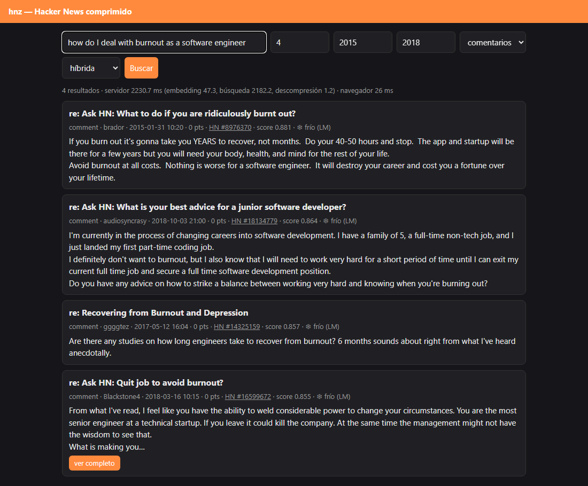
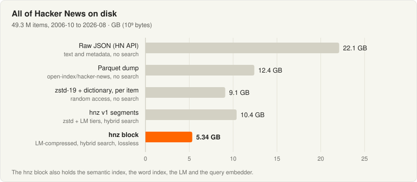
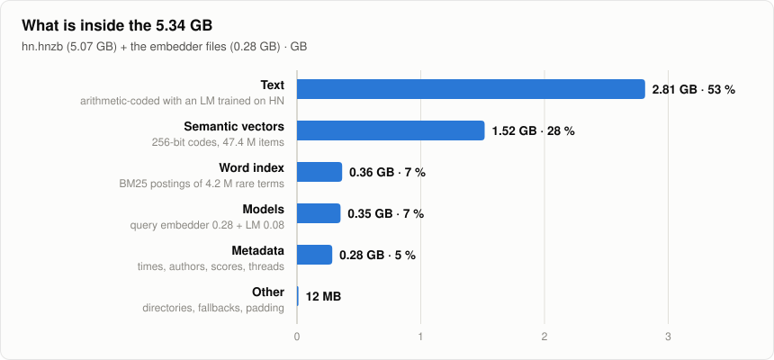
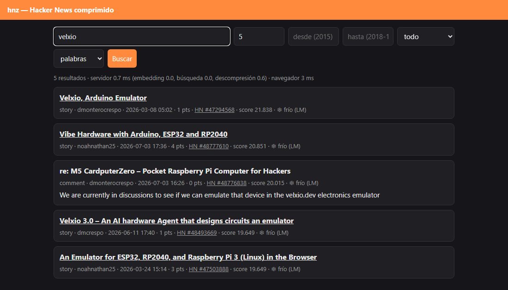
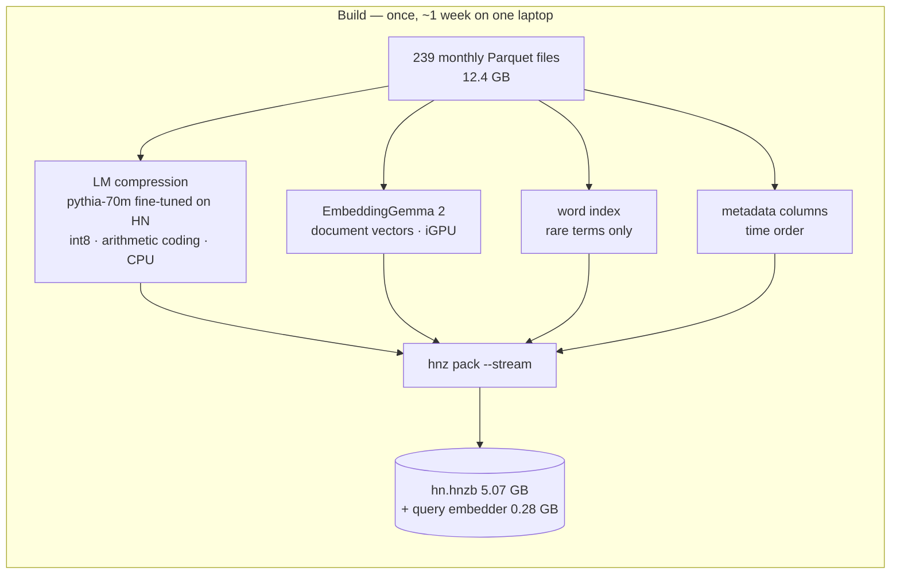
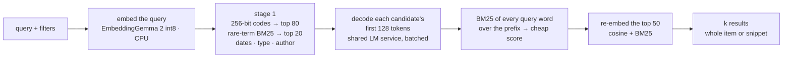
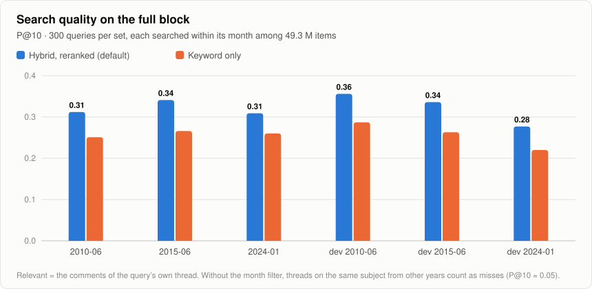
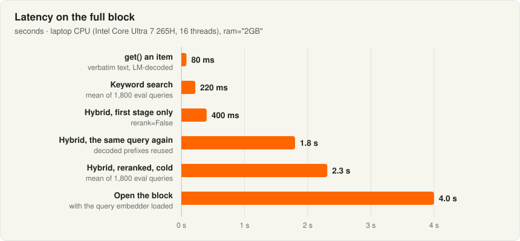
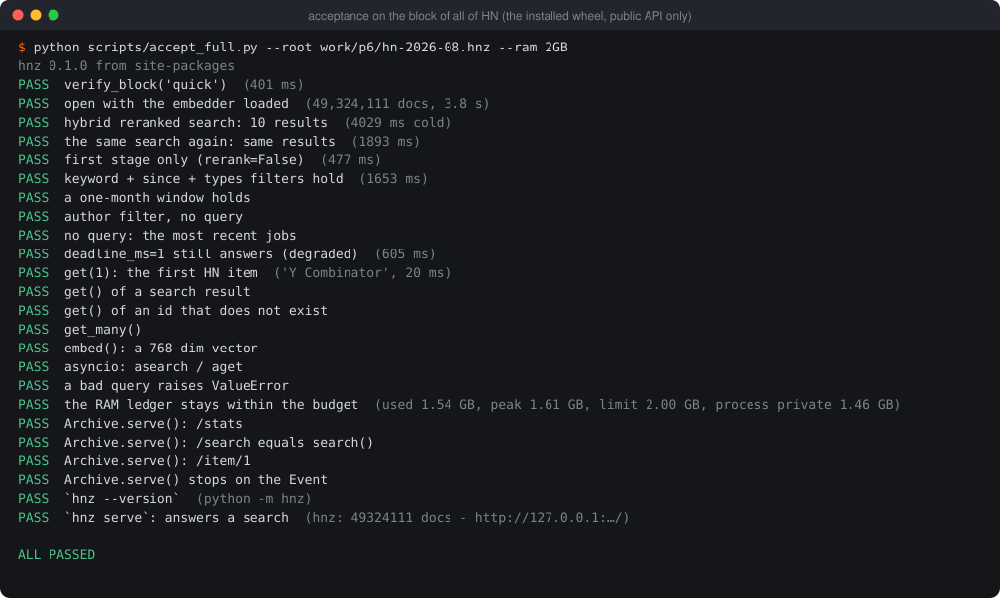
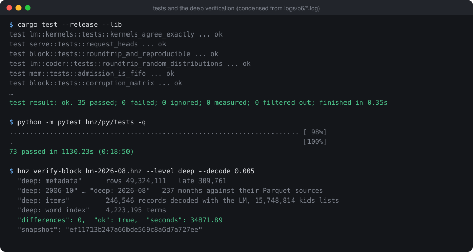

# HNTurboVec — all of Hacker News in 5.3 GB, searchable

**Every Hacker News item ever posted (49.3 M stories, comments, jobs and polls, 2006-10 → 2026-08),
stored losslessly in a single 5.34 GB block, with hybrid semantic + keyword search, filters and
verbatim retrieval — on a laptop CPU, inside a RAM budget you choose.**

```python
import hnz

with hnz.open(r"D:\hn\hn-2026-08.hnz", ram="2GB") as hn:
    for h in hn.search("how do I deal with burnout as a software engineer", k=5,
                       since="2015", until="2018", types="comment"):
        print(h.date, h.by, h.story_title, h.text[:120])
    print(hn.get(1).title)          # 'Y Combinator', byte for byte
```

| | |
|---|---|
| **5.34 GB** | all of HN: text, metadata, semantic index, word index and both models (the Parquet dump is 12.4 GB, the raw JSON ~24 GB) |
| **Lossless** | every item's HTML comes back byte for byte; verified against the sources: 0 differences in 49.3 M items |
| **~2.3 s** | a cold hybrid, reranked search over 49.3 M items on a 16-thread laptop CPU; keyword search ~0.2 s, `get()` ~80 ms |
| **`ram="2GB"`** | models, indexes, caches and every query's working memory stay within the budget (process: ~1.45 GB) |
| **One file** | read-only block `hn.hnzb` + the query embedder; hashed parts, canaries, four verification levels |

<p align="center"></p>

---

## Contents
- [The numbers](#the-numbers)
- [Quick start](#quick-start)
- [How it works](#how-it-works)
- [Quality and speed](#quality-and-speed)
- [Tested](#tested)
- [Tools](#tools)
- [Build the block yourself](#build-the-block-yourself)
- [Repository map and documentation](#repository-map-and-documentation)

## The numbers

<picture>
  <source media="(prefers-color-scheme: dark)" srcset="doc/img/size-dark.svg">
  
</picture>

The block is **smaller than the best general-purpose compressors manage for the text alone** (zstd-19
with a trained dictionary, per item: 9.1 GB, no search), and it carries the search indexes and the
models with it. More than half of it is text:

<picture>
  <source media="(prefers-color-scheme: dark)" srcset="doc/img/block-dark.svg">
  
</picture>

| Part | Bytes | Per item |
|---|---|---|
| Text, arithmetic-coded by an LM (47.4 M records) | 2,813,292,945 | 59 B |
| Semantic vectors (256-bit codes) | 1,516,298,016 | 32 B |
| Word index (BM25 postings of 4.2 M rare terms) | 365,013,098 | 7.4 B |
| Metadata (times, authors, scores, parents, kids) | 284,744,791 | 5.8 B |
| Models: LM 72 MB + tokenizers 4 MB + query embedder 276 MB | 352,112,618 | — |
| Directory, fallbacks, padding | 11,671,963 | — |
| **Total** | **5,343,133,431** | **108 B** |

## Quick start

Requirements: Windows 10/11 on x86-64 with AVX2, Python ≥ 3.10, and a block (built with the steps
in [Build the block yourself](#build-the-block-yourself); it is not distributed in this repository).

```powershell
pip install hnz-0.1.0-cp310-abi3-win_amd64.whl        # built by `maturin build --release` in hnz/py; pulls openvino
```

**From Python** — the full guide is [hnz/py/README.md](hnz/py/README.md):

```python
import hnz

hn = hnz.open(r"D:\hn\hn-2026-08.hnz", ram="2GB", preload=True)

r = hn.search("rust vs go for backend services", k=10)           # hybrid + reranked (default)
r = hn.search("sqlite", mode="keyword", since="2020", types="story")
r = hn.search(author="pg", types="story", k=20)                  # no query: newest first
r = hn.search("kubernetes for small teams", deadline_ms=1500)    # answers in time, degrading if needed
for h in r:
    print(h.rank, h.date, h.kind, h.by, h.title or h.story_title, h.link)

item = hn.get(9700000)              # the whole item; item.html is HN's original HTML
vec = hn.embed("hello world")       # the 768-dim query vector
print(hn.memory()["budget"])        # the RAM ledger: limit, used, peak, per class
# in async code: await hn.asearch(...), hn.aget(id), hn.aembed(text)
```

**Over HTTP** — the `hnz` command comes with the package:

```powershell
hnz serve --root D:\hn\hn-2026-08.hnz --ram 2GB --threads 8 --port 8088
```

`GET /search?q=…&k=10&from=2015&to=2018&type=comment&by=pg&mode=hybrid` returns JSON; `/item/<id>`,
`/stats`, `/memory`; `/` is the search page shown above (`/?q=velxio` opens a search). It is meant
for this machine or a private network; put a reverse proxy in front of it on the internet.

<p align="center"></p>

## How it works





The ideas that make it small:

1. **A language model as the compressor.** Each record is arithmetic-coded with the probabilities
   of a 70 M-parameter LM (pythia-70m, further trained for 93 min on 1 % of HN, −9 % bits). The LM
   runs in hnz's own Rust engine — int8, AVX-VNNI kernels, pinned float arithmetic — so encoding and
   decoding compute identical probabilities on any run: **59 bytes of text per item, against 137
   with zstd-19 and a trained dictionary**.
2. **Store the text once, use it twice.** A query's candidates are reranked by *decoding their
   first 128 tokens* and scoring them again (BM25 over every query word, then re-embedding the top
   50). The stored text acts as a free second index, so the indexes themselves can be tiny:
   **256-bit vectors** (32 B/item) and **BM25 for rare terms only** (names, identifiers, products:
   −73 % in size at the same quality; frequent words are scored on the decoded prefixes).
3. **Time order.** Documents are stored in (time, id) order, so a date filter is a contiguous range
   found exactly from the metadata index.
4. **A RAM budget, not a RAM requirement.** `ram=` plans what stays in memory (models, the hottest
   parts of the indexes, caches) and reads the rest from disk with identical results; every
   query's working memory is admitted against the same ledger.
5. **Paranoid integrity.** Every part is hashed (XXH3-128), canary records are decoded at open, and
   `verify-block --level deep` compares every record with its Parquet source.

Details: [doc/08-block.md](doc/08-block.md) (the block, byte by byte),
[doc/09-rerank.md](doc/09-rerank.md) (search), [doc/07-ram.md](doc/07-ram.md) (RAM governance),
[doc/05-arquitectura.md](doc/05-arquitectura.md) (the engine).

## Quality and speed

<picture>
  <source media="(prefers-color-scheme: dark)" srcset="doc/img/quality-dark.svg">
  
</picture>

Each eval query is a story's title; the relevant items are the comments of that story's own thread.
Searched within the query's month among all 49.3 M items, the hybrid search finds **3.2 relevant
comments in the top 10** on average (keyword only: 2.6). The same queries without the month filter
score ~0.05, because threads on the same subject from other years count as misses in this eval —
the search itself does not degrade with 16× more data (a 3-month block scored 0.24 on the same
queries).

<picture>
  <source media="(prefers-color-scheme: dark)" srcset="doc/img/latency-dark.svg">
  
</picture>

Decoding the candidates' prefixes is most of a cold search (the LM decodes ~1,800 tokens/s per
query on this CPU). Measured on an Intel Core Ultra 7 265H laptop (6 P + 8 E cores), nothing else
running.

## Tested

<p align="center"></p>
<p align="center"></p>

- **Acceptance** on the full block through the installed wheel's public API:
  `python scripts/accept_full.py` (24 checks, ~30 s).
- **Python suite:** 73 tests (`pytest hnz/py/tests`): lossless `get` against Parquet, disk = RAM
  results, concurrency, damage detection (a changed byte anywhere is found, never a crash), RAM
  limits, reranking determinism, the HTTP server.
- **Rust:** 35 unit tests, including bit-exact LM kernels and a corruption matrix.
- **Deep verification** of the full block: every record compared with its source, 0 differences.

How to run each level and what it needs: [doc/10-tests.md](doc/10-tests.md).

## Tools

The `hnz` executable (Rust, `hnz/`) builds, checks and queries archives:

| Command | What it does |
|---|---|
| `hnz pack --stream --spec S --out DIR` | builds a compact block from the monthly LM segments, vectors and global statistics |
| `hnz verify-block BLOCK --level header\|quick\|full\|deep` | checks a block: headers → canaries → every hash → every record against its source |
| `hnz inspect BLOCK [--project N]` | parts, sizes, bytes per document; projection to N items |
| `hnz search`, `hnz get ID`, `hnz serve` | query, fetch an item verbatim, HTTP server |
| `hnz eval --file Q.jsonl --rerank [--within-month]` | P@k and MRR on an eval set |
| `hnz build --tier lm`, `hnz globals`, `hnz prompts`, `hnz lexicon` | the building blocks of `pack` (LM segments, document frequencies, document prompts, word index) |
| `hnz lmtest`, `hnz bench`, `hnz stats` | compression and latency measurements |

Scripts (`scripts/`):

| Script | What it does |
|---|---|
| `download_hn.py` | the whole dataset (239 months, 12.4 GB), resumable, pinned version, SHA-256 checked |
| `prepare_models.py`, `export_*.py`, `compress_embedder.py` | the models: EmbeddingGemma 2 to OpenVINO int8, the LM to hnz's format |
| `train_lm.py` | continued pretraining of pythia-70m on HN text (iGPU, PyTorch XPU) |
| `p5_build.py` | the material of the block, month by month and resumable: LM segments on the CPU, vectors on the iGPU |
| `p6_run.py` | build, pack, verify, test and eval as resumable stages (`p6_start.ps1` restarts it at logon) |
| `accept_full.py` | the acceptance checks of the installed package on the full block |

## Build the block yourself

About a week of machine time on one laptop (CPU for the LM, iGPU for the vectors, both at once):

```powershell
uv venv .venv --python 3.12
uv pip install --python .venv -r requirements-torch.txt --index-url https://download.pytorch.org/whl/cpu
uv pip install --python .venv -r requirements.txt
.venv\Scripts\python scripts\prepare_models.py          # models into models\
.venv\Scripts\python scripts\download_hn.py             # 239 monthly Parquet files into data\ (12.4 GB)
cd hnz; cargo build --release; cd ..                    # the hnz CLI (Rust stable, x86-64-v3)
hnz\target\release\hnz globals --out work\global (Get-ChildItem data\*\*.parquet | % FullName)   # term frequencies
.venv\Scripts\python scripts\p5_build.py lm             # LM segments on the CPU, ~7 days
.venv\Scripts\python scripts\p5_build.py embed          # vectors on the iGPU, ~4.5 days, at the same time
hnz\target\release\hnz pack --stream --spec scripts\pack-all.json --out work\p6\hn-2026-08.hnz
hnz\target\release\hnz verify-block work\p6\hn-2026-08.hnz --level full
cd hnz\py; maturin build --release                      # the wheel
```

Every long step is resumable; `python scripts/p5_build.py status` shows the progress. The packing
itself takes ~1 h and ~3.2 GB of RAM. Every experiment behind each choice — what was tried, the
numbers, what failed — is in [doc/BITACORA.md](doc/BITACORA.md) (36 entries).

## Repository map and documentation

| Folder | Contents |
|---|---|
| `hnz/` | the Rust engine (library + `hnz` CLI) and the Python package (`hnz/py`) |
| `scripts/` | dataset download, models, LM training, the resumable build and the checks |
| `experimentos/`, `resultados/` | the benchmark scripts behind [doc/BITACORA.md](doc/BITACORA.md) and their outputs |
| `eval/` | evaluation query sets (300 queries per month, test and dev) |
| `doc/` | the documentation; `doc/img/` the figures (`make_figures.py` rebuilds them) |
| `data/`, `emb/`, `models/`, `work/` | not in git: the dataset, vectors, models and built blocks |

| Document | About |
|---|---|
| [hnz/py/README.md](hnz/py/README.md) | the Python library: API, HTTP server, performance |
| [doc/README.md](doc/README.md) | project status and the index of every design document |
| [doc/BITACORA.md](doc/BITACORA.md) | the experiment log, E00 → E36 |
| [doc/08-block.md](doc/08-block.md) · [doc/09-rerank.md](doc/09-rerank.md) · [doc/07-ram.md](doc/07-ram.md) | the block format, search, RAM governance |
| [doc/10-tests.md](doc/10-tests.md) | how to test and approve the library |
| [doc/POST.md](doc/POST.md) | the write-up: how it got to 5.3 GB |

Data: [open-index/hacker-news](https://huggingface.co/datasets/open-index/hacker-news) (Hugging Face).
Models: [EmbeddingGemma 2](https://huggingface.co/google/embeddinggemma-2) (Google) and
[pythia-70m](https://huggingface.co/EleutherAI/pythia-70m) (EleutherAI).
